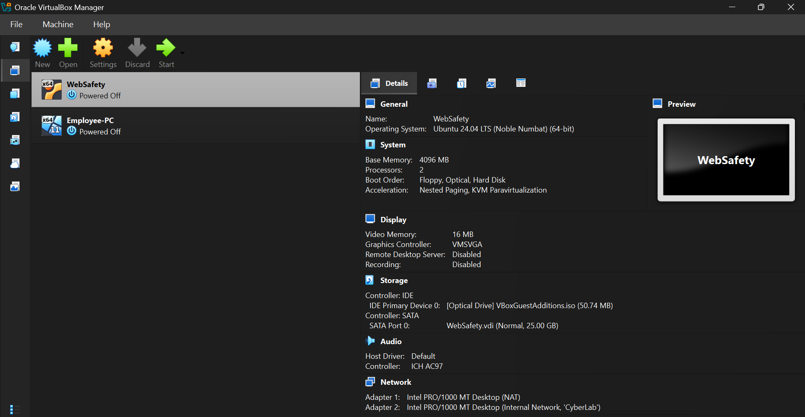
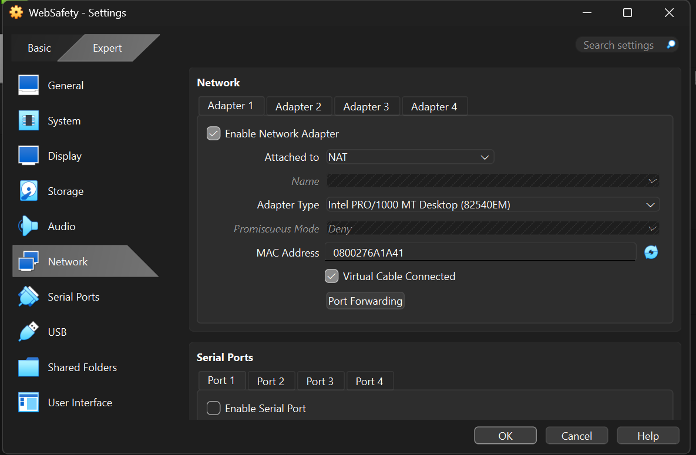
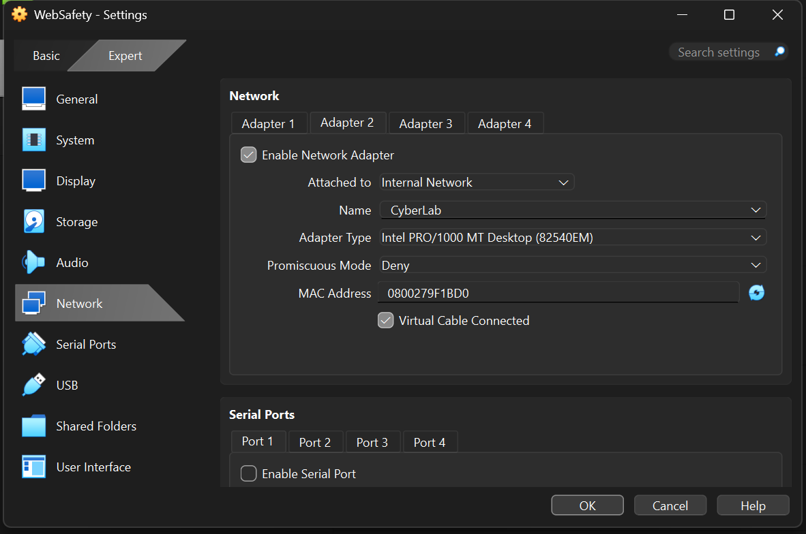
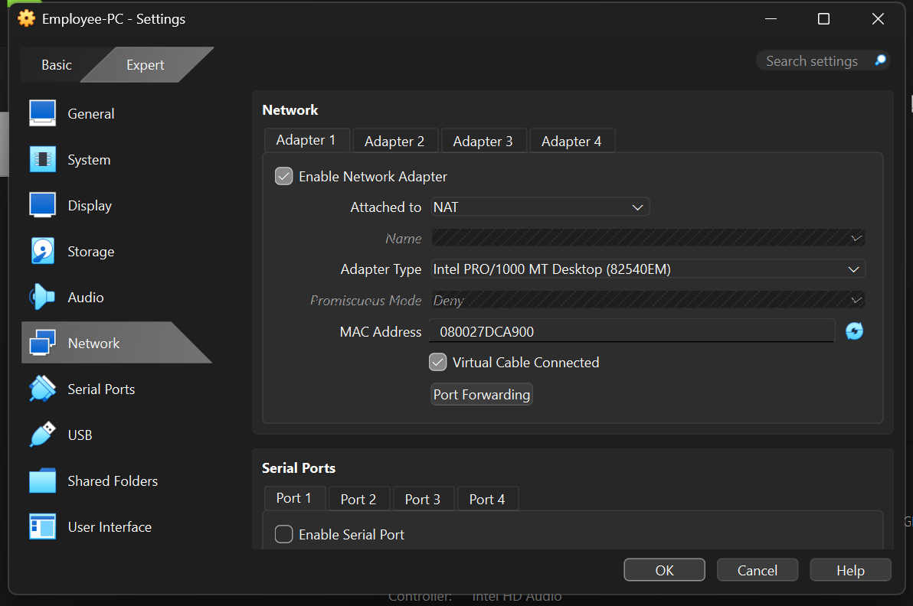
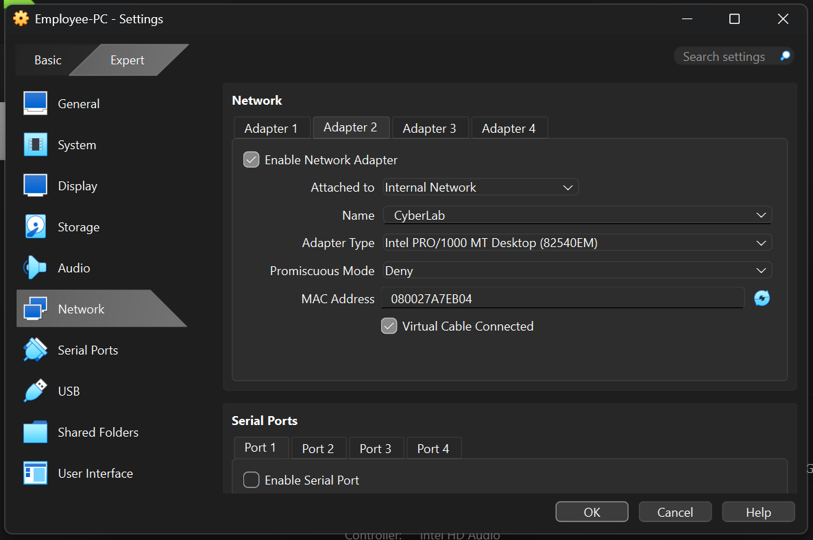

# 01. Environment Setup

## Objective
To establish a virtual lab environment that simulates a basic enterprise network and provides the infrastructure required for web access control and security monitoring.

## Implementation

### 1. Virtual Lab Infrastructure

The lab was built using Oracle VirtualBox with two main virtual machines:

- **WebSafety:** Ubuntu Server used to host Squid Proxy and supporting services.
- **Employee-PC:** Windows virtual machine representing employee devices.

### 2. Network Configuration

The virtual machines were configured with two network adapters:

- **NAT:** Provides internet connectivity.
- **Internal Network (CyberLab):** Enables communication between the virtual machines.

**WebSafety – Network Adapters**

**Employee-PC – Network Adapters**

## Outcome

The virtual lab infrastructure was prepared with internet connectivity and an isolated internal network, providing the foundation for the subsequent proxy configuration and security monitoring stages.
