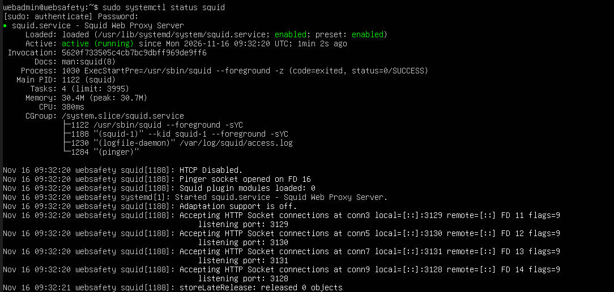
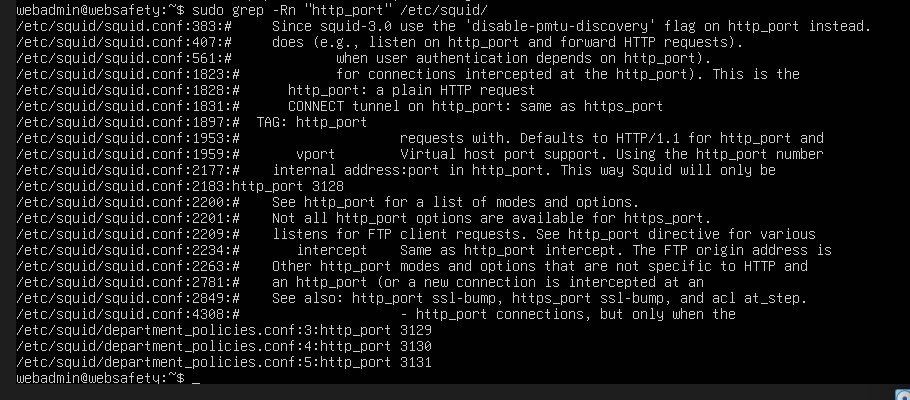

# 02. Proxy and Identity Integration

## Objective

To configure the Squid Proxy server, establish employee identities and department groups using Microsoft Entra ID, and create a mapping mechanism to associate employees with their designated proxy ports.

## Implementation

### 1. Squid Proxy Configuration

Squid Proxy was configured on the Ubuntu server to manage web traffic within the lab environment.

The configuration included:

- Starting and verifying the Squid service.
- Configuring dedicated proxy ports for different departments.
- Enabling Basic Authentication to require user authentication.

**Proxy Port Configuration**

Four proxy ports were configured to support general access and department-based proxy assignments:

| Department | Proxy Port |
|---|---:|
| Default / General | 3128 |
| IT | 3129 |
| HR | 3130 |
| Finance | 3131 |

**Proxy Authentication**

Basic Authentication was configured using the NCSA authentication helper to require valid credentials when accessing the proxy.

### 2. Microsoft Entra ID

Microsoft Entra ID was used to create employee accounts and organize users based on their departments.

**Employee Accounts**

Five user accounts were created to represent employees and administrative roles within the lab environment.

![Entra ID Users](Images/04-Entra
