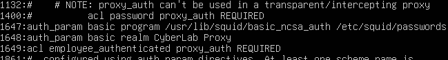
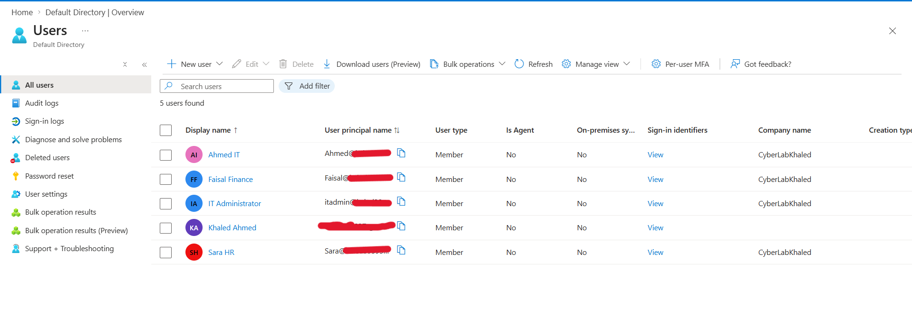
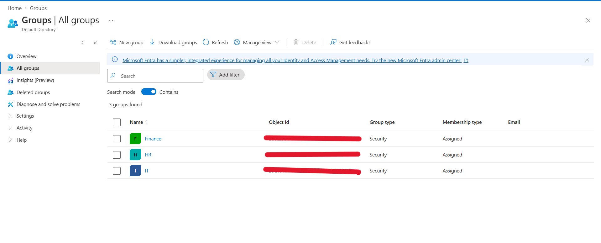
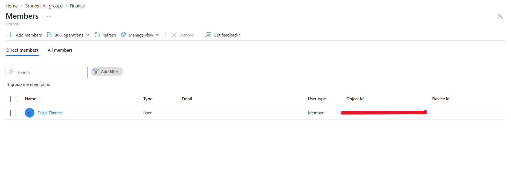
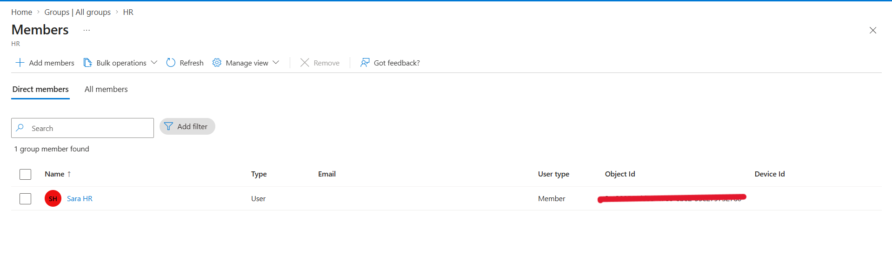
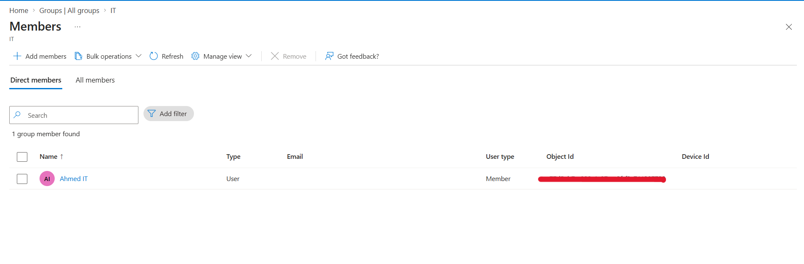
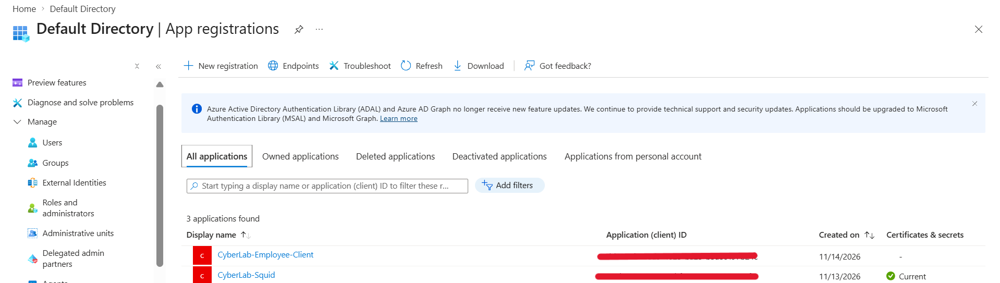
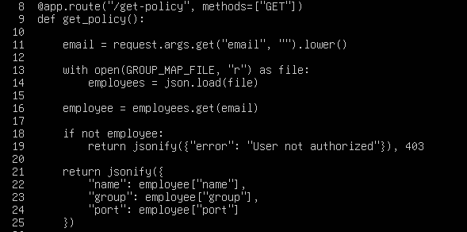
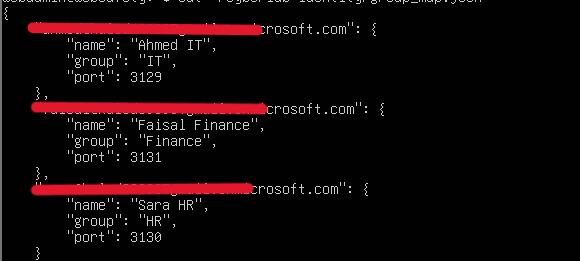

# 02. Proxy and Identity Integration

## Objective

To configure the Squid Proxy server, establish employee identities and department groups using Microsoft Entra ID, and create a mapping mechanism to associate employees with their designated proxy ports.

## Implementation

### 1. Squid Proxy Configuration

Squid Proxy was configured on the Ubuntu server to manage web traffic within the lab environment.

The configuration included:

- Starting and verifying the Squid service.
- Configuring dedicated proxy ports for different departments.
- Enabling Basic Authentication to require user authentication.

**Proxy Port Configuration**

Four proxy ports were configured to support general access and department-based proxy assignments:

- **3128:** Default / General
- **3129:** IT
- **3130:** HR
- **3131:** Finance

**Proxy Authentication**

Basic Authentication was configured using the NCSA authentication helper to require valid credentials when accessing the proxy.

### 2. Microsoft Entra ID

Microsoft Entra ID was used to create employee accounts and organize users based on their departments.

**Employee Accounts**

Five user accounts were created to represent employees and administrative roles within the lab environment.

**Department Groups**

Three Security Groups were created to organize employees into their respective departments:

- IT
- HR
- Finance

**Group Membership Assignment**

Employees were assigned to their corresponding department groups.

**Finance Group**

**HR Group**

**IT Group**

### 3. Application Registration

Two applications were registered in Microsoft Entra ID to establish application identities for the lab environment:

- **CyberLab-Squid**
- **CyberLab-Employee-Client**

### 4. Flask Proxy Policy API

A Flask-based API was developed to retrieve employee information and identify the appropriate proxy port.

The API receives the employee's email address, searches for the corresponding record in a manually maintained JSON file (`group_map.json`), and returns the employee's name, department, and assigned proxy port.

If the employee is not found, the API returns a `403 User not authorized` response.

### 5. Employee-to-Proxy Mapping

A JSON-based mapping file was created to associate employee email addresses with their departments and designated proxy ports.

The mapping was configured as follows:

| Employee | Department | Proxy Port |
| -------- | ---------- | ---------- |
| Ahmed IT | IT | 3129 |
| Sara HR | HR | 3130 |
| Faisal Finance | Finance | 3131 |

## Outcome

The Squid Proxy server was configured with dedicated department ports and authentication settings. Employee accounts and department groups were established in Microsoft Entra ID.

A Flask API and JSON-based mapping mechanism were also implemented to associate employee identities with their designated proxy ports, preparing the environment for department-based web access control and policy testing in the next stage.
