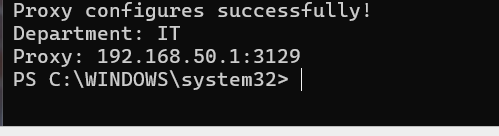
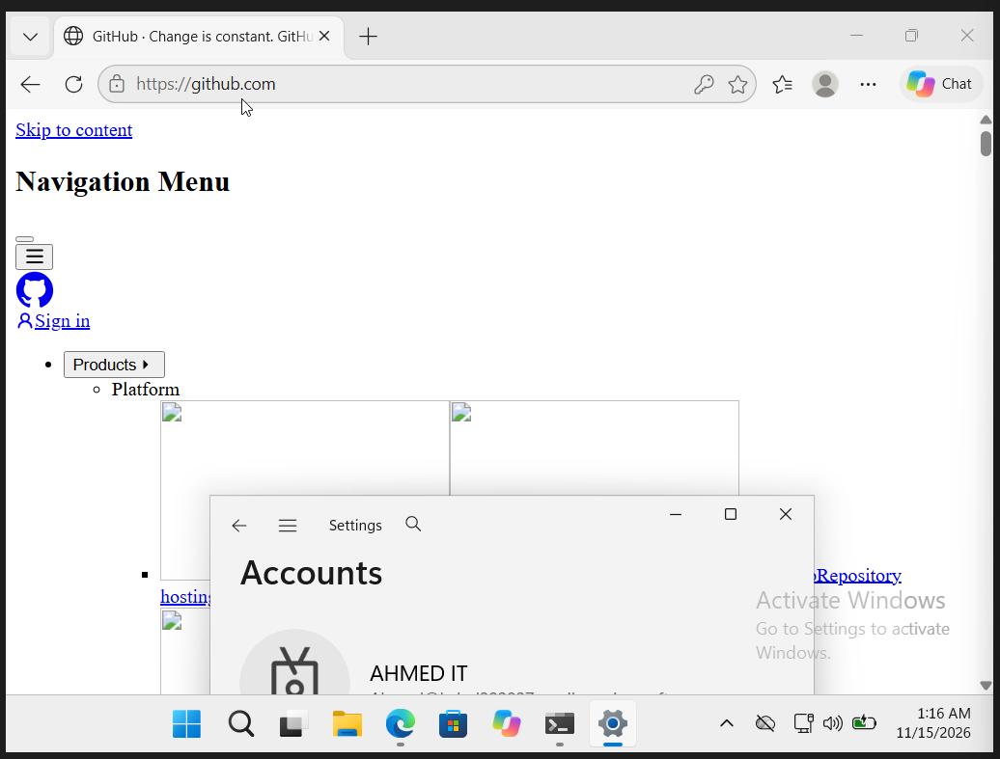
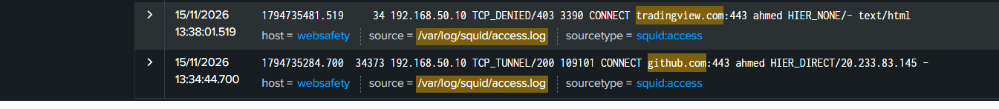
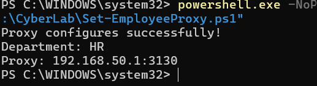
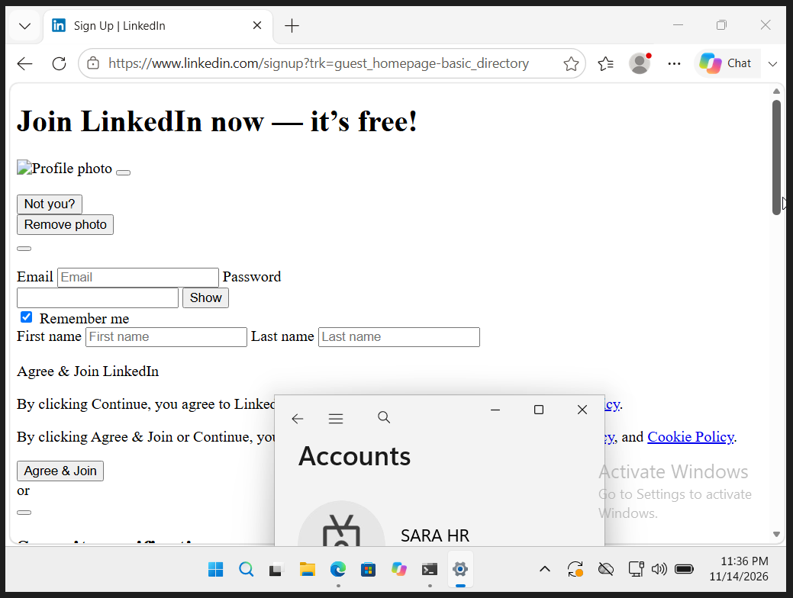
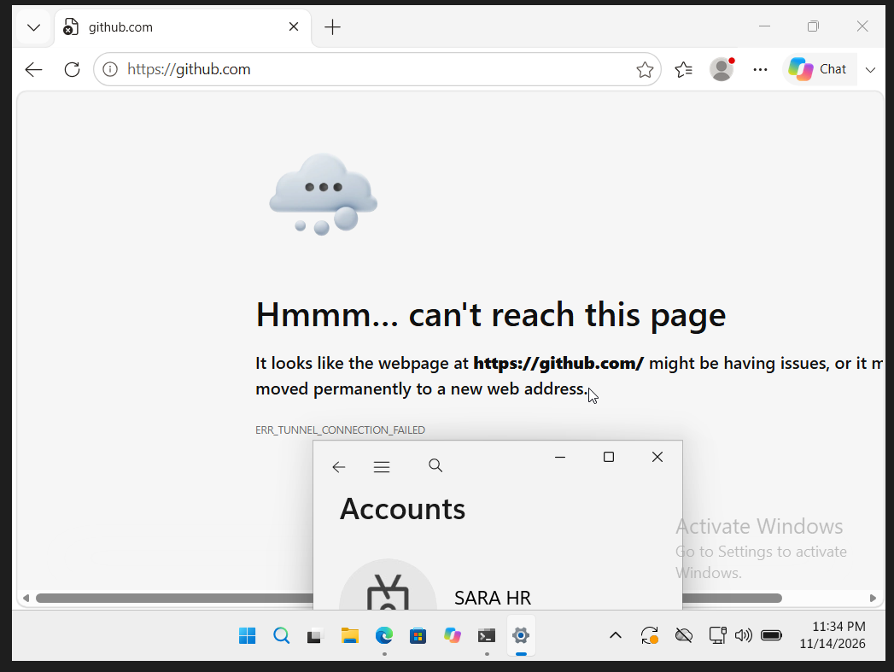
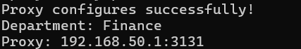

# 03 – Access Policy Testing

## Objective

Verify that department-based web access policies are enforced correctly through the Squid Proxy by testing permitted and blocked websites for IT, HR, and Finance employees.

## Implementation

### 1. IT Department – Ahmed

The IT employee was configured to use the dedicated proxy port `3129`.

**Access Policy Tests:**

- GitHub: Allowed.
- TradingView: Blocked.

The browser tests confirmed the expected access behavior.

Splunk logs confirmed the results through `TCP_TUNNEL/200` for GitHub and `TCP_DENIED/403` for TradingView.

### 2. HR Department – Sara

The HR employee was configured to use the dedicated proxy port `3130`.

**Access Policy Tests:**

- LinkedIn: Allowed.
- GitHub: Blocked.

The browser tests confirmed the expected access behavior.

Splunk logs confirmed the results through `TCP_TUNNEL/200` for LinkedIn and `TCP_DENIED/403` for GitHub.

### 3. Finance Department – Faisal

The Finance employee was configured to use the dedicated proxy port `3131`.

**Access Policy Tests:**

- TradingView: Allowed.
- GitHub: Blocked.

The browser tests confirmed the expected access behavior.

Splunk logs confirmed the results through `TCP_TUNNEL/200` for TradingView and `TCP_DENIED/403` for GitHub.

## Outcome

All six access policy tests produced the expected results across the three departments.

The browser tests and Splunk access logs verified that permitted connections were established and restricted requests were denied according to the configured department policies.
