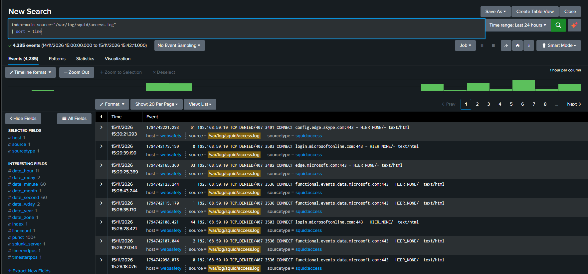
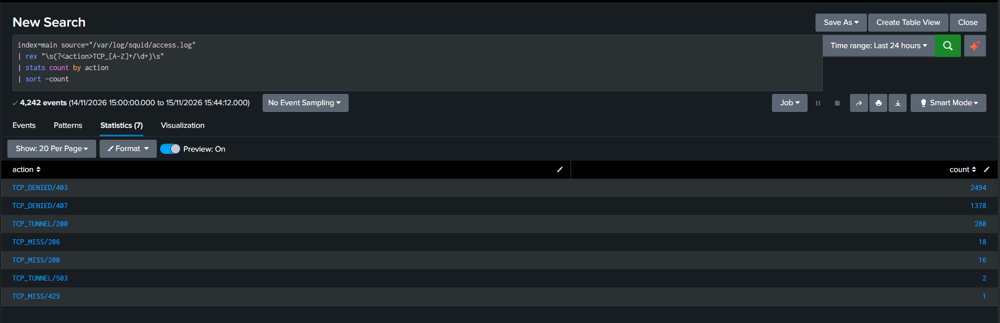
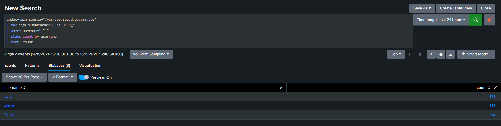
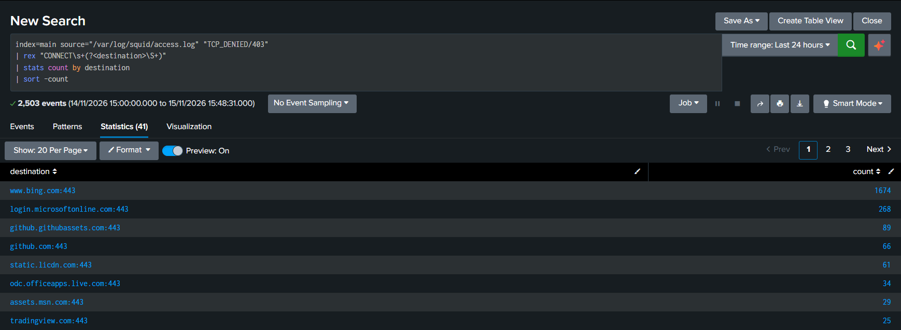
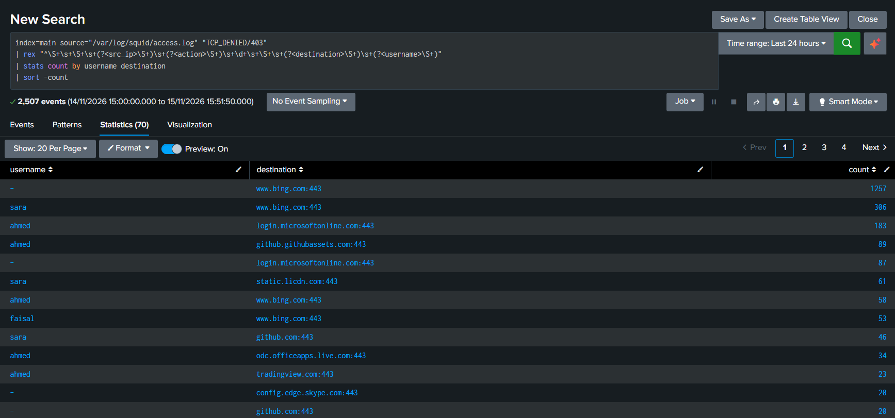
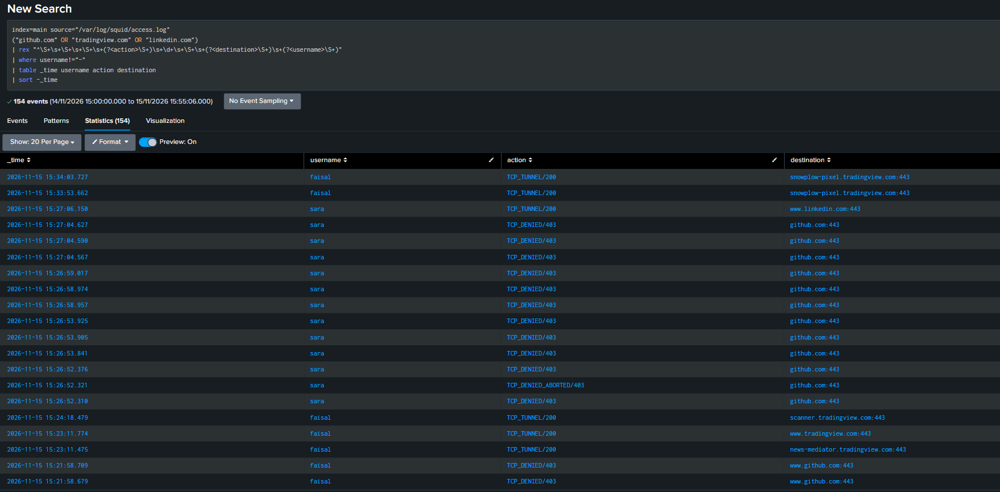
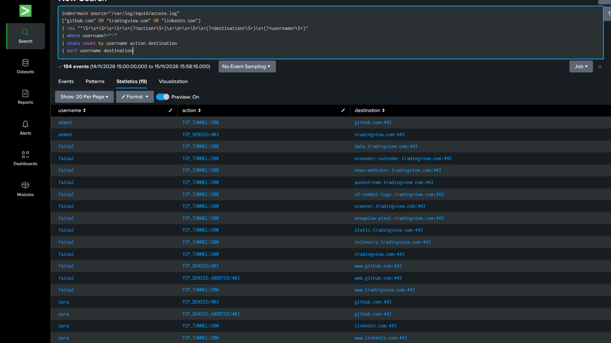

# 04 – Splunk Monitoring

## Objective

Integrate Squid Proxy logs with Splunk Enterprise to establish centralized monitoring and gain visibility into employee web activity.

This stage focuses on analyzing web traffic, monitoring access decisions, identifying blocked destinations, and examining user activity across different departments.

## Implementation

### 1. Log Collection and Initial Review

Configured log forwarding from Squid Proxy to Splunk Enterprise to centralize web traffic events.

The first step was to verify that proxy logs were successfully received and indexed in Splunk before proceeding with further analysis.

### 2. Proxy Event Status Analysis

After confirming successful log collection, the next step was to analyze proxy event statuses to understand how web requests were processed.

Examined the different proxy actions to distinguish between permitted and denied connections, providing an initial overview of web access activity.

### 3. Employee Web Activity Analysis

With the event statuses identified, the analysis moved to individual employee activity.

Reviewed web requests associated with users to understand their browsing behavior and establish visibility into employee web access.

### 4. Blocked Destinations Analysis

Following the user activity review, the investigation focused on blocked web destinations.

Analyzed denied requests to identify websites restricted by the configured access policies and understand which destinations employees attempted to access.

### 5. User and Destination Correlation

To gain more detailed visibility, employee activity was examined alongside requested destinations.

This analysis helped identify which users attempted to access specific websites and determine how the proxy handled their requests.

### 6. Access Policy Investigation

Building on the previous analysis, proxy events were examined to investigate access decisions and understand how the configured policies affected employee web requests.

This step helped evaluate the relationship between user activity and the applied access controls.

### 7. Department Policy Validation

The analysis was then extended across the three departments: IT, HR, and Finance.

Compared their web access activity to examine differences in permitted and denied requests and validate the department-based access policies.

## Outcome

Successfully integrated Squid Proxy logs with Splunk Enterprise, establishing centralized visibility into employee web activity and proxy access events.

The implementation demonstrated how Splunk can support:

- Centralized web traffic monitoring.
- Analysis of allowed and blocked requests.
- Employee activity monitoring.
- Department-based access policy validation.
- Identification of repeated blocked access attempts.

This stage established the monitoring foundation for the next phase: **Dashboard and Alerting**.
