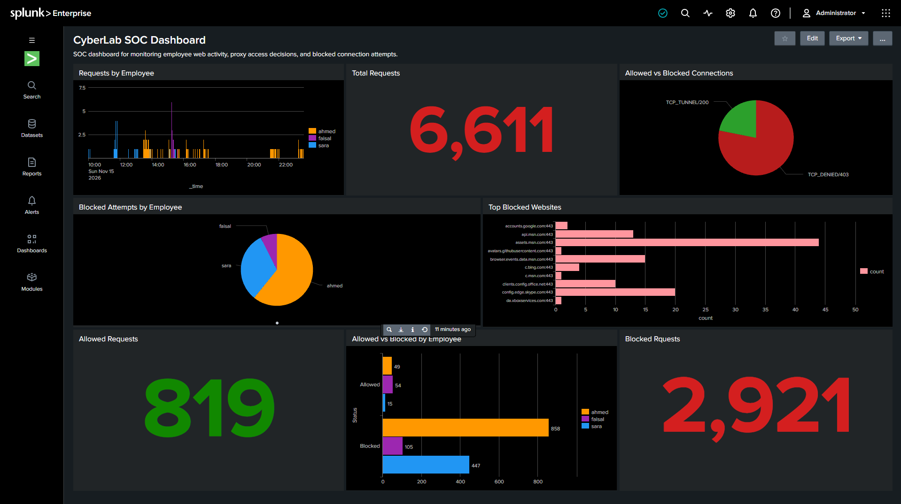
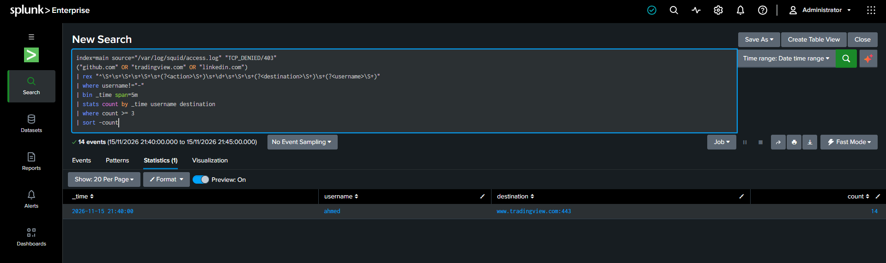
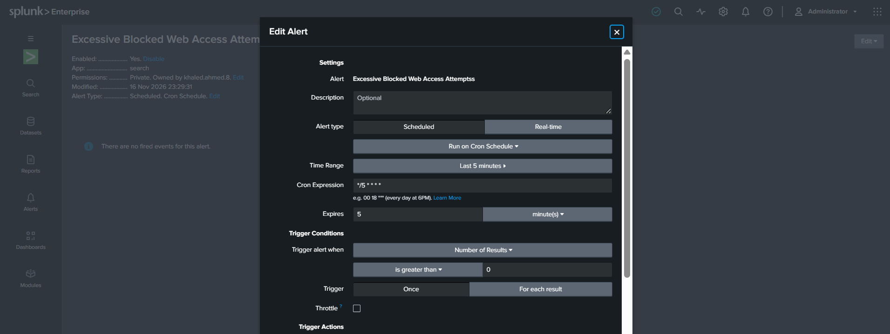
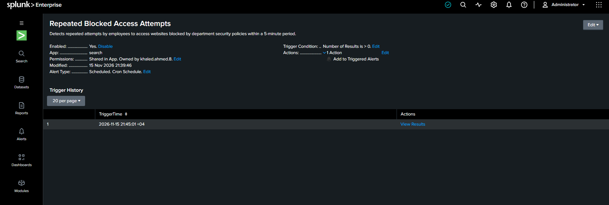

# 05 – Dashboard and Alerting

## Objective

Develop a SOC monitoring dashboard in Splunk to visualize employee web activity, monitor proxy access decisions, and identify repeated attempts to access blocked websites.

The objective is to improve security visibility and demonstrate how repeated blocked access attempts can be detected through automated alerts.

## Implementation

### 1. SOC Dashboard Development

A SOC dashboard was created in Splunk to provide centralized visibility into employee web activity and proxy traffic.

The dashboard includes:

- Total Web Requests.
- Allowed and Blocked Connections.
- Requests by Employee.
- Blocked Attempts by Employee.
- Top Blocked Websites.
- Allowed & Blocked Requests.

### 2. Repeated Blocked Access Detection

A detection search was created to identify repeated attempts to access blocked websites.

The search analyzes Squid access logs and groups blocked requests by time, username, and destination.

A detection condition was configured to identify more than 10 blocked attempts within a five-minute interval.

During testing, the search identified 12 blocked attempts by the user Ahmed targeting TradingView within five minutes.

### 3. Alert Configuration

A scheduled alert named **Excessive Blocked Web Access Attempts** was configured in Splunk.

The alert runs every five minutes and evaluates the detection search results.

The trigger condition is configured to activate when the search returns one or more results.

### 4. Alert Trigger Verification

The alert was tested by generating repeated requests to a blocked website.

Splunk successfully detected the repeated attempts and recorded the alert execution in the Trigger History.

## Outcome

- Developed a centralized SOC dashboard for monitoring employee web activity.
- Visualized allowed and blocked proxy connections.
- Implemented detection logic for repeated blocked access attempts.
- Configured a scheduled alert in Splunk.
- Successfully verified alert execution through Trigger History.

This section demonstrates how Splunk can be used to improve security visibility, detect suspicious access patterns, and generate alerts for further investigation.
