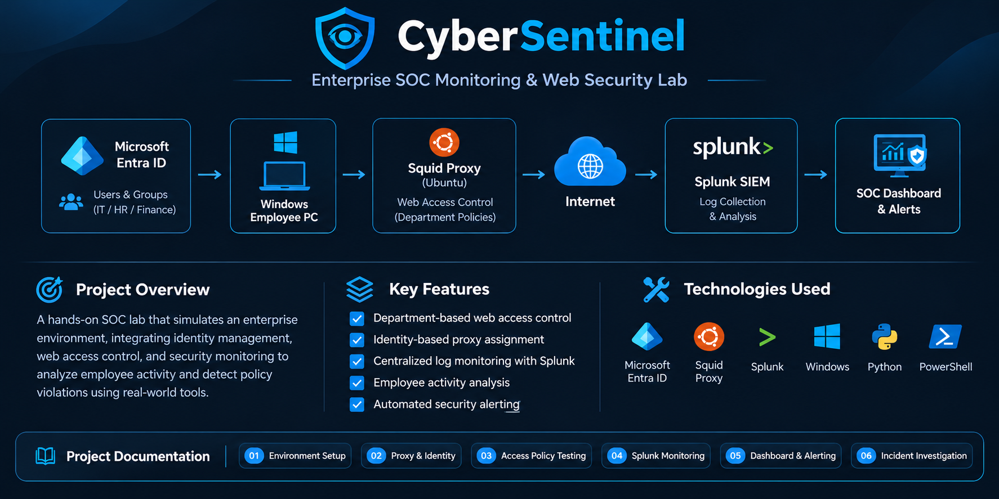

# CyberSentinel
### Enterprise SOC Monitoring & Web Security Lab

## Project Overview

A hands-on SOC lab that simulates an enterprise environment, integrating identity management, web access control, and security monitoring to analyze employee activity and detect policy violations using real-world tools.

## Technologies Used

- Microsoft Entra ID
- Squid Proxy
- Splunk Enterprise
- Ubuntu Server
- Windows
- Python
- PowerShell

## Key Features

- Department-based web access control.
- Identity-based proxy assignment.
- Centralized log monitoring with Splunk.
- Employee activity analysis.
- Automated security alerting.

## Project Documentation

| # | Documentation |
|---|---|
| 01 | [Environment Setup](Documentation/01-Environment-Setup/) |
| 02 | [Proxy and Identity Integration](Documentation/02-Proxy-and-Identity/) |
| 03 | [Access Policy Testing](Documentation/03-Access-Policy-Testing/) |
| 04 | [Splunk Monitoring](Documentation/04-Splunk-Monitoring/) |
| 05 | [Dashboard and Alerting](Documentation/05-Dashboard-and-Alerting/) |
| 06 | [Incident Investigation](Documentation/06-Incident-Investigation/) |
